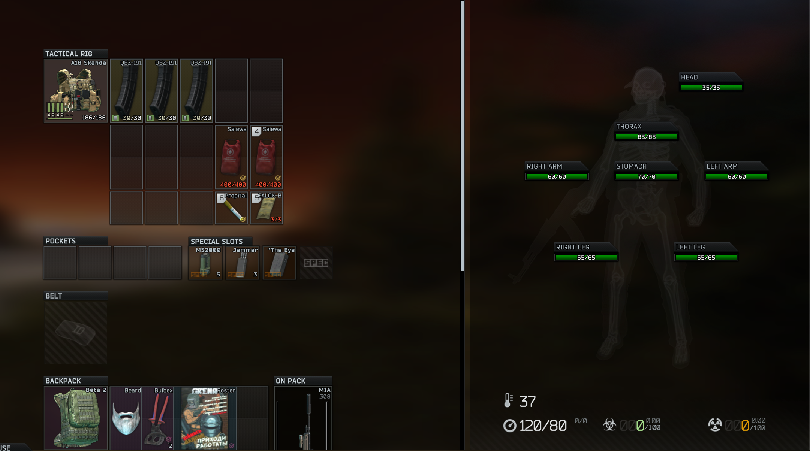

# Healthy Inventory

> *Inspired by the recent Fragmentary Order gameplay.*

**See your health and your gear on one screen.** Press Tab in a raid and your body status is already
there, right beside your loadout. No more switching to the Health tab just to see a body part's
HP or what's bleeding.

## What it does

- **Health beside your gear.** When you open your own inventory in a raid, the right-hand column
  shows the game's Health panel. That column is normally empty unless you're looting.
- **The full picture at a glance:** every body part's HP, bleeds, fractures and other effects,
  plus temperature, blood pressure, toxicity and radiation.
- **No duplicates.** Overall HP, hydration and energy already show in the gear column's bottom
  strip, so the health column leaves them out.
- **It's the game's own panel, not a copy.** Numbers, icons, tooltips and drag-and-drop treatment
  work just as they do on the Health tab, and mods that add to the Health panel show up here too.
- **Looting is unchanged.** Searching a body, a container or a loose bag gives you the normal
  looting layout with its full loot space.
- **Raids only.** The stash, hideout, traders and every other out-of-raid screen stay vanilla, and
  the Health tab works as it always has.

## Install

1. Download the latest release zip.
2. Extract it into your SPT folder, so that `BepInEx/plugins/HealthyInventory.dll` exists.
3. Start the game.

## Settings

Open the in-game configuration manager with **F12**.

| Setting | Default | What it does |
| --- | --- | --- |
| Show health beside gear in raid | On | Turning it off restores the vanilla layout at once. |
| Column background and frame | On | Gives the health column the same background, bottom strip and border as the gear column. |
| Log layout decisions | On | Writes a short line to `BepInEx/LogOutput.log` on each open, for troubleshooting. |

## Compatibility

- **Any resolution or window size.** The column follows resolution and window-size changes, even
  with the inventory open.
- **Scav raids** work the same as PMC raids.
- **UI Fixes:** tested together, no problems found.
- **Fika** and **CutContent / Re-Classic:** their code doesn't touch anything this mod uses, but
  they haven't been run together yet.
- **Mods that rebuild the inventory layout:** if the panels aren't where the game normally puts
  them, Healthy Inventory leaves the inventory vanilla and writes a warning to the log.

## Feedback

Found a problem? [Open an issue](https://github.com/JoelHauser/healthyinventory/issues) and attach
`BepInEx/LogOutput.log`.

## How it works

The game already has a Health panel inside the inventory screen, stacked in the same space as the
gear slots, and the Gear/Health tabs choose which one is visible. On the Gear tab of your own
in-raid inventory, Healthy Inventory moves that panel into the empty right-hand column, shows it
with the game's own code, and puts it back when the inventory closes, the tab changes or a loot
panel opens. The mod draws nothing of its own, so the panel stays native and keeps up with game
updates.
